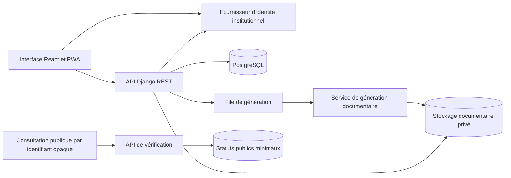

# Architecture de SIGDA

SIGDA et SSDC sont des projets indépendants. SIGDA aura ses propres comptes, données, déploiements et procédures d’exploitation.

## Atelier livré

Le parcours guidé alimente les documents depuis `AgentRecord` (SQLite) : nom, matricule, service, fonction et grade. Le serveur relit le dossier du compte OPS et valide les champs propres à chaque modèle. Un ticket signé lié au compte et limité à une heure enregistre la copie des données et le texte dans `DocumentRequest.payload`.

Le circuit est OPS → SECAD → AP → DIRCAB. Un seul groupe SIGDA définit le rôle actif d’un compte ; plusieurs groupes métier entraînent un refus des actions. Les tâches portent une attribution nominative, un auteur d’attribution, un profil, un cycle, une révision, une empreinte de contenu et une échéance facultative. Une contrainte garantit une seule tâche en attente par document. Les transitions utilisent une transaction et une mise à jour conditionnelle du statut, cycle et numéro de révision. Le prochain responsable doit appartenir au bon profil ; le propriétaire et les validateurs précédents sont exclus des choix. L’auto-approbation est interdite.

Les retours motivés créent une tâche OPS ; une correction n’est possible qu’en brouillon et crée une nouvelle révision. Une nouvelle soumission ouvre un nouveau cycle. La décision finale requiert les validations SECAD et AP de la même révision et empreinte. Le PDF final est alors archivé avec son SHA-256. Les consultations servent ces octets et contrôlent leur empreinte. Avant cette décision, les routes PDF refusent la sortie et les aperçus PNG portent un filigrane. Les anciens exemples n’ont plus de sortie PDF publique.

`RequestEvent` décrit les décisions, `ValidationTask` les responsabilités, `DocumentAccess` les ouvertures de fichiers émis et `UsageEvent` les actions instrumentées (connexions, aperçus, saisie et transitions). DIRCAB seul accède à la route globale d’activité. Le serveur transmet des métadonnées de calcul, sans corps des documents. `statistics.js`, partagé avec la démonstration publique, calcule les séries calendaires à Kinshasa, les quantiles interpolés, les distributions et l’intervalle de Wilson. Les graphiques sont accompagnés de tableaux accessibles et de leurs définitions. Le journal affiché présente les 50 dernières actions de la période ; les agrégats utilisent toutes les actions disponibles de cette période.

La démonstration GitHub Pages simule les quatre profils dans le même navigateur et conserve agents, demandes et événements dans IndexedDB. Les contrôles locaux servent à démontrer les responsabilités, pas à protéger des données. Elle compose la version personnalisée en HTML A4, avec QR local et mise en page Times New Roman si disponible. Le service statique ne reçoit pas les données saisies et ne les synchronise pas entre appareils. Le moteur PDF Django incorpore Times New Roman. Tous les exemples restent fictifs et marqués comme spécimens.

L’Assistant dispose d’un guidage local par correspondance de termes. Le mode GPT optionnel appelle l’API Responses depuis le serveur avec une clé issue de l’environnement, jamais livrée au navigateur. La reformulation transmet le corps du texte à OpenAI uniquement lorsque l’utilisateur choisit cette action. Les sorties sont proposées à la relecture et ne modifient ni le statut d’une demande ni les gabarits.

La PWA de démonstration publique simule la connexion sur GitHub Pages. Elle publie uniquement des données fictives. Pour la démonstration et l’atelier local, le service worker conserve seulement la page de reprise hors connexion.

## Architecture cible

Le service de vérification expose uniquement le statut, la référence, la date et une catégorie générique. Les dossiers agents, les pièces et les rémunérations restent dans le périmètre privé. Le service worker utilise une liste explicite de ressources statiques. Les parcours protégés exigent une connexion au serveur.

## Modèle de données à implémenter

| Entité | Rôle et contraintes |
| --- | --- |
| Agent | Matricule unique, service et fonction. Affectations et grades historisés. |
| Dossier et pièce | Un dossier par agent. Chaque version de pièce possède sa propre empreinte et un objet privé. |
| Modèle et version | Une catégorie documentaire référence une version de modèle validée et ses champs autorisés. |
| Demande et transition | La demande référence l’agent et la version du modèle. Chaque transition journalise l’auteur, la date et le motif. |
| Document et émission | Le brouillon peut être régénéré. L’émission fige le fichier, sa référence et son empreinte. |
| Séquence de référence | Une séquence par direction et année. Attribution dans la même transaction que l’émission avec contrainte d’unicité. |
| Rémunération | Ressource distincte avec habilitation et journalisation des consultations. |
| Vérification | Identifiant opaque et statut de délivrance ou de révocation. |

## Invariants à vérifier avant une recette institutionnelle

- L’identité institutionnelle et l’habilitation métier sont vérifiées côté serveur à chaque action protégée.
- L’accès à une demande ou à une pièce vérifie la ressource demandée, le périmètre du compte et son rôle.
- L’approbation, la signature, la délivrance et la révocation sont des opérations distinctes. Les circuits soumis à la séparation des fonctions refusent l’auto-approbation.
- L’émission lie la référence à la version exacte du modèle et à l’empreinte du fichier final. Une révocation modifie le statut de vérification et conserve la trace de la décision.
- L’atelier de démonstration et le système institutionnel utilisent des déploiements et des jeux de données séparés.
