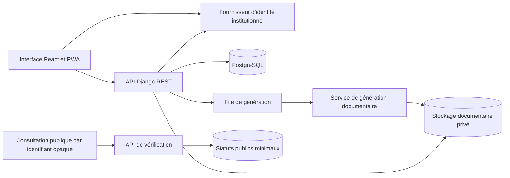

# Architecture de SIGDA

SIGDA et SSDC sont des projets indépendants. SIGDA aura ses propres comptes, données, déploiements et procédures d’exploitation.

## Atelier livré

Le serveur Django présente le catalogue fictif et génère les deux PDF à la demande. Un compte Django et sa session donnent accès à l’atelier et à ses documents. La sélection ne transmet que deux identifiants de catalogue. Les PDF sont marqués comme spécimens et leurs réponses interdisent la mise en cache. L’aperçu et le téléchargement appellent le même générateur. Le catalogue en mémoire est réservé à cet atelier local.

La PWA de démonstration publique simule la connexion sur GitHub Pages. Elle publie uniquement des données fictives. Pour la démonstration et l’atelier local, le service worker conserve seulement la page de reprise hors connexion.

## Architecture cible

Le service de vérification expose uniquement le statut, la référence, la date et une catégorie générique. Les dossiers agents, les pièces et les rémunérations restent dans le périmètre privé. Le service worker utilise une liste explicite de ressources statiques. Les parcours protégés exigent une connexion au serveur.

## Modèle de données à implémenter

| Entité | Rôle et contraintes |
| --- | --- |
| Agent | Matricule unique, service et fonction. Affectations et grades historisés. |
| Dossier et pièce | Un dossier par agent. Chaque version de pièce possède sa propre empreinte et un objet privé. |
| Modèle et version | Une catégorie documentaire référence une version de modèle validée et ses champs autorisés. |
| Demande et transition | La demande référence l’agent et la version du modèle. Chaque transition journalise l’auteur, la date et le motif. |
| Document et émission | Le brouillon peut être régénéré. L’émission fige le fichier, sa référence et son empreinte. |
| Séquence de référence | Une séquence par direction et année. Attribution dans la même transaction que l’émission avec contrainte d’unicité. |
| Rémunération | Ressource distincte avec habilitation et journalisation des consultations. |
| Vérification | Identifiant opaque et statut de délivrance ou de révocation. |

## Invariants à vérifier avant une recette institutionnelle

- L’identité institutionnelle et l’habilitation métier sont vérifiées côté serveur à chaque action protégée.
- L’accès à une demande ou à une pièce vérifie la ressource demandée, le périmètre du compte et son rôle.
- L’approbation, la signature, la délivrance et la révocation sont des opérations distinctes. Les circuits soumis à la séparation des fonctions refusent l’auto-approbation.
- L’émission lie la référence à la version exacte du modèle et à l’empreinte du fichier final. Une révocation modifie le statut de vérification et conserve la trace de la décision.
- L’atelier de démonstration et le système institutionnel utilisent des déploiements et des jeux de données séparés.
